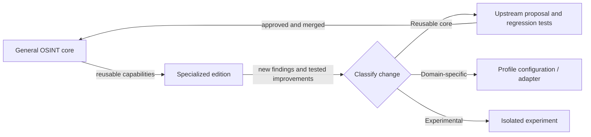

# FATHER OSINT · registry of specialized profiles

The [OSINT_deepseek](https://github.com/VictorKVS/OSINT_deepseek) repository is the **general OSINT agent**. Specialized editions provide domain configurations, workflows and validations; they are not independent forks of the core.

| ID | Specialized edition | Purpose | Status |
|---|---|---|---|
| FATHER-OSINT-TRICOLOR | [OSINT_TRICOLOR](https://github.com/VictorKVS/OSINT_TRICOLOR) | Media rights, brand/trademark protection and internet threat monitoring | MVP / integration planned |

**User's local working folder for the specialized edition:** `G:\1\OSINT_TRICOLOR`.

## Mandatory bidirectional improvement flow

Every reusable improvement made in an industry edition **must be evaluated for upstream integration** into the main agent; it is not considered integrated until it passes API compatibility, privacy/security review, regression tests and is merged.

- Shared components: collection policy interfaces, normalized records, evidence provenance, audit, dedup, correlation, evaluation and report interfaces.
- Industry adapters: rights and license registers, content classifications, risk weighting and templates.
- General changes should be proposed against this repo; industry-only changes stay downstream.
- Once a generalized feature is released from the core, downstream editions should consume it rather than maintaining a parallel implementation.

See [OSINT_TRICOLOR's candidate log](https://github.com/VictorKVS/OSINT_TRICOLOR/blob/main/docs/UPSTREAM_CANDIDATES.md).

**Safety:** lawful public sources, minimized personal data, no unauthorized access or automated claims, human review.
